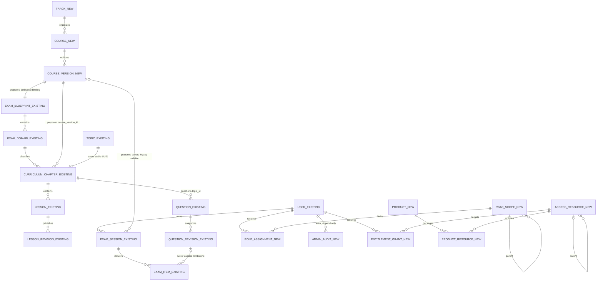

# Phase 9A — multi-track architecture recommendation

Baseline: `7e3e6c16cbfd2a87682d1e28da0e0939f29d5005`, `main`. **Design only; nothing here is implemented or activated.** Source facts and exact locations are in [coupling inventory](phase-9a-coupling-inventory.md). Database changes, grants, role bootstrapping and product policy require the separate decisions in [owner decisions](phase-9a-owner-decisions.md).

## Fact, recommendation, assumption and approval boundaries

| Category | Finding / implication | Evidence |
| --- | --- | --- |
| EXISTING AND VERIFIED IN SOURCE | Chapter UUID = topic UUID; questions and lessons reference that stable identity. | `lib/db/src/schema/curriculum-chapters.ts:20–23`; `questions.ts:66`; `lessons.ts:40` |
| EXISTING AND VERIFIED IN SOURCE | Domains belong to blueprints; chapter FK binds domain ID, blueprint ID and domain code. | `lib/db/src/schema/exam-blueprints.ts:40–56`; `curriculum-chapters.ts:33–37` |
| EXISTING AND VERIFIED IN SOURCE | Current permission role is global USER/ADMIN from PostgreSQL, not a Clerk role claim. | `lib/db/src/schema/users.ts:12,22`; `artifacts/api-server/src/middlewares/auth.ts:135,164,176` |
| PARTIALLY IMPLEMENTED | Earlier architecture mentions extensible roles, but schema/middleware do not implement scoped assignments. | `docs/architecture/authorization.md:5` versus the users/auth sources above |
| MISSING | Track, course, course-version, scoped role assignments, entitlement/access-resource registry and administrative audit-log model. | Bounded schema export review: `lib/db/src/schema/index.ts`; permission/access consumers: `auth.ts:requireAdmin`, `lesson-media.ts:readLessonMedia` |
| REQUIRES LIVE VERIFICATION | Deployed data, ACL, ownership, RLS and runtime catalog match source. | Source expectations: `tools/phase6a-local/policy.mjs:assertLedger,runtimeTableInventory`, `tools/study-activation/proposed-runtime-guard.mjs:assertStudyPolicies` |

Everything described below is an **ARCHITECTURAL RECOMMENDATION**, not a claim of present behavior. Proposed schema names are conceptual. Exact DDL, enum/storage choices and migration number are deliberately not assigned.

## Model choice

Recommended navigation: **Track → Course → CourseVersion → existing Domain → existing Chapter → existing Lesson**. A Track is catalog organization, not a tenant or an authorization boundary by itself. CourseVersion identifies an immutable curriculum edition, not the application's UI language or an exam session. Published lesson revisions remain content revisions within one chapter/version.

| Alternative | Evaluation | Decision |
| --- | --- | --- |
| Full seven mandatory entity levels | The requested chain contains six named levels. Interpreting a seventh as a Module between Domain and Chapter adds an entity/API/editor and forces migrations for CCNA without an established need. Independent new domain/chapter tables would require remapping stable UUIDs and references. | Reject mandatory seventh level now. An optional grouping module can be deferred; owner must name it and justify a concrete use case. |
| Flat Course → Lesson | Easy catalog prototype, but discards chapter/domain relationships used by questions, imports, skill evidence, practice filters and chapter lesson links. Cannot distinguish editions without overloading course identity. | Reject; source dependencies are C08–C29 in the inventory. |
| In-place chapter generalization with course_version_id | Add Track/Course/CourseVersion and attach existing chapters; retain topic bridge, domain/blueprint bindings and lesson IDs. Most references derive scope through the chapter instead of being rewritten. | Recommend additive-first, with guarded backfill and compatibility resolver. |

Proposed identities and invariants:

- `tracks`: stable ID, unique slug, localized presentation metadata and lifecycle. Initially one primary track per course. If cross-listing becomes real, add an explicit join later; do not clone a course to show it in another track.
- `courses`: stable ID, primary track FK, unique public slug; no copied exam session state or owner privileges on the row.
- `course_versions`: course FK, immutable version key, lifecycle, and an explicit compatible taxonomy/blueprint binding. Distinct published versions do not share mutable chapter rows. New edition → new chapter/topic UUIDs when content structure changes; existing CCNA UUIDs remain attached to the original edition.
- `curriculum_chapters.course_version_id`: nullable only during transition, then mandatory after verified backfill. Keep `id → topics.id`, `questions.topic_id → curriculum_chapters.id` and `lessons.chapter_id → curriculum_chapters.id`. Keep existing global topic slugs; use globally namespaced slugs for new chapters initially (`lib/db/src/schema/topics.ts:20`).
- `exam_domains` and `exam_blueprints`: reuse existing taxonomy initially. Recommend one dedicated blueprint/taxonomy identity per course version for this first generalization, with enforced course-version ↔ blueprint correspondence. No implicit reuse of a domain ID across different versions. Future shared official blueprints need an explicit mapping layer, not an accidental many-to-many.
- Existing chapter volume/number can remain storage fields in the first version. Treat volume as a grouping code and make meaning profile-driven. A course not expressible in the current bounded fields is blocked pending an explicit additive schema proposal; do not truncate its labels or fabricate a V1/V2 book.
- Question identity belongs to its chapter/version initially. Cross-course reuse means an explicit future question-placement model; do not make topic_id ambiguous or reparent historical questions. Existing CCNA-Q codes remain opaque globally unique historical codes (C12).

### Conceptual ERD

NEW/EXISTING labels are explicit. Relationship labels “proposed” are not current database FKs. RBAC and commerce do not derive from the content tree automatically.

The scope/resource registries need typed, validated bindings to existing IDs (platform/track/course/version/lesson as applicable). The ERD omits join-table detail for readability; a naked `kind + arbitrary UUID` without referential checks is **not** the proposed integrity mechanism.

## Preserve canonical CCNA integrity without a hardcoded course UUID

Current three chapter CHECKs enumerate UUIDs, bound V1/V2 and format CCNA codes (C03–C05). A generic CHECK like `course_version_id = '<ccna-uuid>' OR ...` is rejected: it hides product configuration in DDL and becomes brittle with new editions/restores. Also reject a CHECK calling a mutable lookup function: cross-row changes do not safely revalidate all referencing rows. PostgreSQL CHECKs are not a substitute for relational referential integrity.

Recommend an immutable, migrator-managed **chapter catalog/profile**:

1. A `curriculum_catalogs` registry has a stable semantic key (for example, the existing CCNA catalog key), version and reviewed digest. The database-generated catalog ID is referenced, never embedded as a magic course UUID in generalized CHECKs.
2. `curriculum_catalog_entries` contains allowed catalog/chapter UUID/code/grouping/number/domain-code tuples. Import the exact existing CCNA tuple set **and its existing actual chapter codes**; copy no authored text into this control table. Read-only app permissions only. No application role may edit canonical entries.
3. Each course version references exactly one catalog and its dedicated taxonomy binding. Add referential bindings so every chapter's version/catalog/blueprint correspondence and complete tuple match are enforceable with FKs and supporting unique keys. One possible representation adds catalog_id to chapters and uses a composite FK to entries plus a composite FK to the version's catalog/blueprint binding. Code/number/id/domain remain tied together.
4. New courses have their own explicitly reviewed catalog entries. Initially use the same strong allowed-entry mechanism for all courses; do not expose broad registry writes to generic Admin CRUD. If dynamic chapter authoring is later needed, provide a narrowly reviewed management function that cannot mutate an existing immutable CCNA catalog or turn a canonical profile into a permissive one.
5. Keep the three old CHECKs until the new registry bindings are installed and validated for every CCNA chapter. Replacing the old CHECKs is a later approval gate, not the first additive migration.
6. Retain generic CHECKs for nonempty codes/positive bounds and course-scoped uniqueness. Any relaxations of exam-domain/objective notation are separate from the three chapter CHECKs; use profile-specific authoritative definitions rather than weakening all certification validation.

CCNA title/slug edit restrictions in `canonical-chapters.ts:42–45` remain a dedicated application adapter; database tuple checks alone do not protect names in topics. Proposed catalog immutability is enforced by restricted ownership/grants and reviewed mutation entry points; a stored hash alone is only evidence, not enforcement.

**Non-certification course decision:** current published visibility requires ACTIVE blueprint, whose verification requires a source URL and verified timestamp (`exam-blueprints.ts:37`; `lessons.ts:295`). Do not mark arbitrary course metadata “officially verified” just to satisfy this. Recommend separating course publication lifecycle from external exam verification in a later approved change, preserving the CCNA adapter's current stricter rules. Until that decision is implemented and tested, non-certification course activation is blocked.

## Scoped RBAC, separate from learner access

Recommended roles: platform OWNER, platform ADMIN, scoped course/track ADMIN or EDITOR/PUBLISHER, and existing learner USER. Final role vocabulary is an owner decision, not an added enum in this phase.

A code-defined, versioned permission map enumerates capabilities such as catalog.read, content.edit, content.publish, media.manage, learners.summary.read and roles.delegate. Assignments reference a real typed scope; assignment inheritance follows only approved scope ancestry. Content editing does not automatically grant role delegation, learner private notes, or access to every course.

Clerk continues to verify identity/session. The API resolves the PostgreSQL user and checks ACTIVE status as now (`auth.ts:requireAuthenticatedUser`). Role/entitlement claims in a token or UI-selected course are not authoritative. Future effective permissions come from DB assignments and the code map; caches require a short bounded TTL/version and invalidation on assignment/status change. Stale tabs reauthorize at mutation time.

### Least-privilege role-management operations

Do **not** grant the normal app role broad INSERT/UPDATE/DELETE on role_assignments or audit rows. Recommended approval package:

- Narrow management functions (grant/revoke/change assignment), schema-qualified objects, fixed safe search_path, revoked PUBLIC EXECUTE, dedicated non-login owner with only required object rights. Grant EXECUTE only to an approved management caller. Prefer a separate server-side management DB credential/channel for highest-risk ownership operations if the owner selects that boundary.
- API derives actor from verified auth, never accepts actor from request JSON; function rechecks actor ACTIVE and delegated permission, target, role, scope, expected assignment version and idempotency key. A shared DB login plus an actor argument/GUC is **not cryptographic proof** of the end-user identity. If a compromised general API worker must be unable to impersonate role managers, a separate trusted management channel is required; this is an explicit security decision.
- Each operation takes a **transaction-scoped serialization lock on an existing authority/scope guard row** before checking permissions and owner count, then locks affected assignment/user rows in deterministic order. Bootstrap must provide that guard row first. Count effective **active** owners after the proposed change, including status changes and cascading permission loss; never count only stored OWNER labels.
- Prevent self elevation, self delegation to a broader scope, self demotion/disable, granting above the actor's delegable ceiling, and assigning platform scope from course authority. Require a separate authorized actor for exceptional self-management. Break-glass procedures are out of normal application APIs.
- Last-owner protection must cover concurrent revocations, demotions, user status changes and any future delete path. Route-only prechecks or independent count→write queries are insufficient. Do not add status mutation while it can bypass the same locked invariant.
- Append an audit event in the **same transaction** as the accepted change: actor/target IDs, scope, before/after assignment, reason, request correlation/idempotency key, database UTC timestamp and outcome. Never tokens/raw private learner answers. Audit insertion failure aborts the mutation. Restrict direct audit UPDATE/DELETE; archive/export policy is owner-approved. External rejected-request logs supplement the transactional success log; do not commit a partial authority change just to retain a denial.
- Compare expected versions, return a conflict for stale edits, verify postconditions before commit, and make exact retries return the same result. Test opposing concurrent owner removals, target disable races and lost-connection uncertainty in isolation before approval.

Existing code has no OWNER or assignment functions; user-role/status updates are withheld (`tools/phase6a-local/05-grant-runtime.sql:40–41`). SQL deletion functions currently recheck global ADMIN (`0016_safe_lesson_deletion.sql:9`, `0017_exam_simulator.sql:105`). A scoped UI/API alone cannot authorize those safely. Keep destructive capability restricted to the existing global Admin until a separately approved, equally strict replacement is reviewed.

### Lesson RLS compatibility

Keep `lesson_annotations_owner` and `lesson_progress_owner` exactly owner-scoped, and transaction-local app.study_user set from the verified actor (`0014_interactive_study.sql:25,40`; `study.ts:31`). Course Admin is not the learner. Never impersonate a learner via app.study_user for monitoring; do not use table-owner/BYPASSRLS connections for ordinary reads.

Current monitoring deliberately returns lessonActivity:null (`routes/admin-learners.ts:34`). Any approved aggregate monitoring needs its own narrowly scoped authorization/data-minimization/RLS design, not a reuse of private workspace queries. Current controlled-deletion definer's all-owner integrity checks are exceptional existing safeguards, not a reusable staff-read pattern.

## Independent entitlements and resource access

A course-only boolean is insufficient: it cannot distinguish a preview lesson, one paid lesson, a bundle containing several courses, or an expiring subscription without awkward exceptions. Recommend **resource authorization independent of roles and payment products**.

- Typed access resources represent course, version and individual lesson with validated parent links. Their mapping to lesson IDs creates new inbound FK dependencies and must be reviewed with C49 **before** installation.
- Policy vocabulary: FREE_OPEN, FREE_PREVIEW, ENTITLED. Recommend per-action interpretation: metadata discovery, full lesson read, media read, practice start, exam start. A free preview grants only explicitly defined preview actions/content; do not send a full lesson body then hide paid sections in CSS.
- Preserve current authentication by default. “FREE_OPEN” means no purchase entitlement for the allowed action; it does **not** silently remove requireAuthenticatedUser. Anonymous previews/sign-in requirements require a separate owner decision.
- A central canAccess(actor, action, resource, clock) resolves ACTIVE account, published/version state, closest explicit resource policy and valid direct/ancestor/product-derived grants. Unknown/unmapped resources fail closed. An inherited FREE policy cannot silently override an explicit child ENTITLED policy. A granted full-course entitlement may cover paid descendants only if its approved coverage explicitly says so.
- Grants specify user, resource, allowed actions, effective start/end, source (manual/product/subscription), grant/revocation metadata and idempotency identifier. Revocation/time expiry is evaluated server-side; product membership alone never proves current access.
- Products/bundles map to explicit resource sets or approved descendant coverage; pin version coverage at issuance by default. Whether existing buyers get future editions/future bundle additions is an explicit contract decision. Future billing can issue/revoke grants without changing every lesson API. No checkout, payment service or subscription engine is part of Phase 9.
- Manual grants use controlled management functions and transactional audit, not unbounded app-role writes. Authorization-manager privileges and the learner's purchase rights remain independent.
- Recheck canAccess at API list/count/detail/export/new-delivery boundaries. Existing private notes remain owned even if course access expires; policy for exporting the learner's own notes versus disclosing quoted paid content needs owner approval.

### Media and shared-reference rules

Current `readLessonMedia` accepts any visible published reference or global Admin (`lesson-media.ts:176`). Proposed behavior: allow bytes only when the actor can access **at least one current published referencing lesson**, or has the explicit scoped administrative media capability. Authorize before 304/ETag decisions and keep private cache variation. Validate variants and direct UUID URLs identically.

A media file referenced by both a free and paid lesson is effectively available through the free reference; warn/review that sharing at publication, do not pretend the same bytes can remain secret. Do not assign a global “paid” property to shared lesson_media rows or move their S3 objects. Draft media library search/reuse needs a separately approved shared/per-course catalog policy. Opaque existing ccna-lessons keys remain valid (C31).

## Minimal exam and practice generalization

Current contracts remain untouched in this phase (`exams.ts:28–32`; `routes/exams.ts`; `practice-batch.ts:11`). Future changes should be additive:

1. Resolve course_version_id server-side before availability/start; validate all chapter/domain IDs belong to that version and authorize it. No domains selected means all **within that version**. Keep safe count/duration bounds, server clocks, randomized-once selection and original deadline.
2. Add a nullable exam_sessions.course_version_id for legacy compatibility. New starts require an explicit resolved value. Include version identity in immutable session config and new mapping snapshots; preserve existing unique (user_id,request_id) and reject reuse with a different version/config.
3. Never recompute old mapping_snapshot or question_revisions hashes. Pin historic attribution in additive sidecar metadata if necessary, using captured snapshot.topic IDs, not a question's current mutable classification. Ambiguous/tombstoned history stays explicitly legacy/unknown until an approved mapping is proven.
4. The exam state trigger compares all non-mutable fields (`0017_exam_simulator.sql:69,76`), so course identity becomes immutable too. Updating historic session rows for backfill would require a separately reviewed controlled migration; recommend leaving them nullable rather than disabling the trigger.
5. Practice single/batch/Nexus paths must independently verify chapter→version/access. New learning sessions may gain version context if needed; old deliveries/attempts remain pinned to captured revisions and user/session ownership. Replay/history should not be regraded when catalog metadata changes.
6. Scope query keys, cursor context, availability responses and scoped history explicitly; preserve legacy all-history views only where named as such. Changing locale never changes scope, session identity or cache ownership.
7. Decide access expiry mid-session before implementation. Recommended initial rule: entitlement rechecked on new session start and direct content reads; a short already-issued, owner-bound timed exam may finish under its captured access lease/deadline. This rule is proposed, not current; revocation/account disable must still deny unauthorized use according to approved policy.

## Phase 9 boundary

**Recommended Phase 9 foundation:** additive catalog identities, preserved CCNA adapter/IDs/deep links, version-scoped eligibility/analytics/imports, safe context selection, independently designed resource policy/manual grants and scoped RBAC only after their DB/security approval gates. Stage these in separate reviews; identity/scoping may ship before any role or commerce management.

**Deferred:** mandatory extra hierarchy level, content translation, physical tenant isolation, arbitrary taxonomy notation, cross-course shared question placements, content version cloning tools, adaptive exams, official scoring claims, checkout/payment/webhooks, subscription lifecycle automation, bulk role editing and private-lesson monitoring bypasses. Nothing in this design authorizes changes to current records, auth, migrations or running services.
