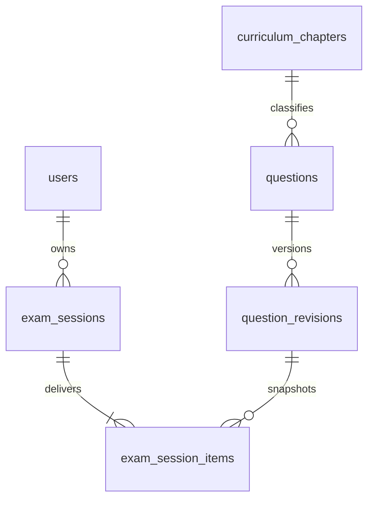

# Unified NEXUS shell and database-backed exam simulator

## Latest continuation status

Phase 2 source implementation continued on 2026-10-19. See [the implementation and verification report](exam-simulator-implementation.md). Migration 0012 is still proposed only. The user chose to leave the private cluster stopped, so PostgreSQL integration and active-database rollout are blocked. The original design below records the intended architecture; the implementation report lists the small contract/permission differences and actual test results.

## Original delivery status and approval boundary

Phase 1 consolidates the application shell in source. It changes no database schema or data. Phase 2 below is a concrete design for review, not an implemented exam service or applied migration. The attachment requires design/approval before the full exam implementation. No migration, seed, reset, grant, backup restore or application-database connection was executed for this work. Existing uncommitted work, including migration history and the lockfile, is retained.

## Root causes verified in source

`App.tsx` mounted separate shells per route. `/`, `/practice`, `/practice/history` and `/profile` used `NexusAppShell`; `/topics`, `/exam` and all Admin routes used `SharedShell` with legacy `ApplicationNavigation`. This produced different branding and navigation and remounted shell state when switching pages. Exam and Administration links in the NEXUS sidebar also lacked active-state handling. An additional Admin module navigation repeated the sidebar destinations.

`pages/exam-simulator.tsx` is a retired in-memory demo. `NEW_DEMO_SESSIONS_ENABLED=false` deliberately prevents starting it. `routes/index.ts` registers Practice and NEXUS services, but no exam delivery or grading router. `learning_sessions_mode_ck` allows LEARN/PRACTICE/REVIEW_MISTAKES only; no durable exam deadline or exam result model exists. Removing that flag would restore fake local sessions, not satisfy database-backed exams.

## Phase 1 shared architecture

`ApplicationRoutes` keeps Clerk sign-in/up pages at their existing URLs and gives every workspace route one persistent `NexusAppShell` around the page switch. Each page's content and all existing Admin role/access/cache boundaries remain in use. The shell is not keyed by route. The route-scoped content error boundary can recover without replacing navigation.

The single sidebar renderer supplies desktop and Radix mobile drawer navigation. It uses the existing server-derived, identity-scoped `/api/auth/me` query for Admin visibility, never token role claims. Signed-out, pending and failed role queries show no Admin destinations. Backend authorization remains authoritative. Existing account menu/profile/sign-out behavior and base-path redirects are reused. All six learner links and all five current Admin destinations remain available:

| Label | Existing URL |
| --- | --- |
| Command Center | `/` |
| Learning Curriculum | `/topics` |
| Challenge Arena | `/practice` |
| Learning Intelligence | `/practice/history` |
| Learner Profile | `/profile` |
| Exam Simulator | `/exam` |
| Administration | `/admin` |
| Topics | `/admin/topics` |
| Questions | `/admin/questions` |
| Taxonomy | `/admin/taxonomy` |
| Bulk import | `/admin/import` |

All destinations already exist; no placeholder routes were added. Exact matching distinguishes `/practice` from its history route and Admin overview from Admin modules. Nested module destinations can retain their owning active item without matching similarly named prefixes. Collapsed links keep accessible names. The drawer shares the same links, has a named dialog, closes on selection/Escape and restores focus through the existing Radix trigger. A skip link targets the single main landmark. Sidebar content scrolls on shorter screens; the existing mobile breakpoint and NEXUS typography/colors remain.

Only workspace content is routed; React Query and Clerk providers remain outside the shell. Navigating normally unmounts the previous page, preserving its existing save/unsaved-change/session mechanisms; this change does not promise to keep arbitrary unsaved page forms mounted. Sidebar collapse state persists between workspace pages. Authentication pages intentionally retain their dedicated layouts.

## Phase 2 proposed schema: migration 0012

The next available migration number is 0012 after the source's twelve-entry 0000–0011 chain. Reverify the actual ledger, raw source checksums and schema through the guarded hidden-prompt workflow before any active-database execution. Do not infer application state from source promotion alone.

Use two exam-specific tables, reusing the existing question bank, immutable revisions, canonical chapter IDs and grading helpers. Do not add EXAM to the existing practice modes, duplicate questions or attach exams to practice deliveries. Reusing a practice delivery would let a learner try the existing Practice answer endpoint to obtain feedback before the exam ends. Exam delivery IDs must be recognized only by the exam service.



### `exam_sessions`

| Field | Proposed type and invariant |
| --- | --- |
| `id` | UUID primary key, server-generated |
| `user_id` | UUID NOT NULL, RESTRICT FK to existing users |
| `request_id` | UUID NOT NULL, UNIQUE `(user_id, request_id)` for idempotent creation |
| `auth_session_id` | varchar(255), NOT NULL, creation metadata from verified Clerk session |
| `status` | ACTIVE / SUBMITTED / EXPIRED; terminal status immutable |
| `config` | versioned JSON object: requested count, duration, explicit domain/chapter filters, grading-policy version |
| `question_count` | integer, 1–100, exact successfully delivered item count |
| `started_at` | timestamptz, PostgreSQL clock |
| `deadline_at` | timestamptz, strictly after start; 5–180 configured minutes |
| `finalized_at` | nullable timestamptz, required only for terminal states |
| `effective_finished_at` | terminal timestamp; deadline for expiration, accepted submission time otherwise |
| `result` | nullable validated JSON totals and domain/chapter breakdown; terminal only |

Add owner binding UNIQUE `(id,user_id)`, history index `(user_id,started_at DESC,id)`, and an active deadline index. CHECK the status/timestamp/result combinations, bounded question count/duration and JSON shape. Immutable identity/config/start/deadline and terminal-result triggers prevent later accidental mutation. Terminal results include policy version, total, correct, incorrect, unanswered, percentage, duration seconds and snapshot mapping breakdowns. There is no official passing-score claim or mandatory pass/fail field.

### `exam_session_items`

| Field | Proposed type and invariant |
| --- | --- |
| `delivery_id` | UUID primary key, server-generated exam-only delivery identity |
| `session_id`, `user_id` | composite RESTRICT FK to `(exam_sessions.id,user_id)` |
| `position` | zero-based integer 0–99, UNIQUE `(session_id,position)` |
| `question_id`, `revision_id` | composite RESTRICT FK to existing immutable revision binding |
| `mapping_snapshot` | versioned JSON chapter UUID/code/title/volume/number and domain UUID/code/name at delivery time |
| `required_selection_count` | integer from validated revision's correct-answer count; one for single, at least two for multiple |
| `selected_keys` | JSON string array, default empty, distinct normalized option keys |
| `flagged` | boolean, default false |
| `answer_version` | nonnegative integer for optimistic concurrency between tabs |
| `graded_result` | NULL while active; terminal correctness and response classification |
| `deleted_question_code`, `deleted_at`, `deletion_audit_id` | nullable controlled-deletion tombstone fields |

UNIQUE `(session_id,question_id)` prevents duplicate questions in an exam. Index `(question_id,revision_id)` and `(user_id,session_id,position)` for deletion/ownership queries. Live-versus-tombstone CHECK constraints make the states mutually exclusive. Tombstones clear revision/question pointers, selected keys and question-specific feedback under the existing audited deletion function only. Mapping snapshot shape is validated; no foreign key to mutable chapter metadata is needed for the snapshot. All new FKs use RESTRICT, never cascading deletion of shared sessions or users.

Deadline-aware functions/triggers validate selection membership/count bounds, lock the owning session, reject draft writes at/after deadline and after finalization, and protect graded fields and timestamps from ordinary draft updates. Use narrowly scoped table/column grants plus specific function EXECUTE permissions; no runtime DELETE/TRUNCATE, PUBLIC privileges or unrestricted history updates. Exact grant requirements must be reviewed with the migration and tested as the runtime role, not assumed from owner success.

### Controlled question deletion compatibility

The existing `delete_question_with_history` architecture and dependency preview must explicitly account for exam items before release. New RESTRICT FKs must not be bypassed. An ordinary deletion reports the exact exam/history dependency. An Admin's separate destructive-history confirmation includes affected exam items and the shared-session consequence.

The controlled function records recovery evidence in the existing protected deletion audit, redacts only the selected question's exam items into tombstones, and retains unrelated items and the session row. Active exams with removed content cannot be graded as complete; show a clear CONTENT_REMOVED state and require starting another exam. For already graded exams, preserve original aggregate scores with a conspicuous partial-review/redacted-history indicator, while removing the selected item's answer/revision access. Do not silently recompute unrelated learner results or remove shared sessions. This extension is part of the reviewed 0012 migration/function fingerprints, not an application-side constraint bypass. No real question/history deletion is authorized as a test.

## API contract

All routes mount under the existing Express `/api` router and require `requireAuthenticatedUser` with active server-resolved user status. The browser supplies neither an authoritative owner UUID nor a role. Return `Cache-Control: no-store`. Validate IDs, filters, array sizes, counts and bodies strictly. Bound query sizes and paginate history.

| Method and path | Contract |
| --- | --- |
| GET `/api/exams/availability` | Optional repeated domainIds/chapterIds; returns eligible count and available canonical domain/chapter counts, bounds, feature readiness and no question text/keys |
| POST `/api/exams` | `{requestId,questionCount,durationMinutes,domainIds:[],chapterIds:[]}`; atomically creates or returns the same owned session for an identical request; changed config with same request ID -> 409 |
| GET `/api/exams/:id` | Owned resume state, serverNow/deadline, safe question snapshots, selections, flags, answer versions and status; no active keys/explanations |
| PATCH `/api/exams/:id/items/:deliveryId` | `{selectedOptionKeys:[],flagged,expectedVersion}`; save/clear the full selection and review flag with session lock and clock check; stale version -> 409 |
| POST `/api/exams/:id/submit` | Finalize from persisted selections, not a client score; return one persisted result. Repeats return the same result without regrading |
| GET `/api/exams/:id/result` | Owned terminal result with correct keys/explanations from the immutable revision; active/unfinalized -> 409 |
| GET `/api/exams` | Cursor-paginated own history: status, start/end, score, duration, removed-content indication; no other learners |

Mutation requests use the existing verified-current-session header convention to reject stale browser auth. Ownership is by internal user UUID, so a learner can resume after reauthentication; the original Clerk session is audit metadata, not authorization to access a different learner's record. Unknown and other-owner IDs both yield 404. No new Admin exam-history endpoint is proposed; Admin role alone must not bypass learner isolation through these routes.

Standard sanitized errors: VALIDATION_ERROR (400), UNAUTHENTICATED (401), NOT_FOUND (404), AVAILABILITY_CHANGED / SESSION_CHANGED / VERSION_CONFLICT / EXAM_CLOSED / CONTENT_REMOVED (409), FEATURE_NOT_READY (503). Unexpected failures return a sanitized request reference and roll back; no fabricated success.

### Availability and delivery

Eligibility requires ACTIVE/published question, ACTIVE topic, valid canonical chapter and domain/blueprint, supported question type and structurally valid answer choices. Single-answer revisions have exactly one correct answer; multiple-answer revisions have at least two. With both domain and chapter filters, use their intersection and reject inconsistent selections rather than guessing mappings. Never consult the retired 53-objective classification. A zero-question bank displays a useful empty state, not demo content.

Count and start use the same eligibility predicate. Start rechecks inside a bounded transaction, locks selected question/topic rows in a consistent order with Admin editors, captures existing immutable revisions using `captureQuestionRevision`, randomizes the persisted item order once, and refuses the whole creation if availability falls below the requested count. A retry never reshuffles an already-created exam. Uniform random selection is explicitly labeled as platform practice; official domain weights are displayed for learning context but no official Cisco exam distribution is promised. Count/duration maxima are enforced on the server as well as in the UI.

### Grading, deadlines and concurrency

Equal weighting: one point per complete correct-answer set, zero partial credit. Single-answer selection must contain exactly one option. Multiple-answer drafts may be incomplete while editing; submission requires exact set equality, independent of order, for credit. Empty selections are unanswered; nonempty incomplete/wrong selections are incorrect. `incorrect = total - correct - unanswered`; percentage is `100 * correct / total`, rounded for display only. Do not invent a Cisco passing score.

Reuse `normalizeSelection` / `revisionFeedback` for validation and full-set grading, handling empty and partial selections explicitly before calling exact-answer helpers. The required selection count is captured from the revision; it cannot change when the live question is edited. Grading snapshots use revision content and delivery-time chapter/domain mappings, not current question rows. No learner-facing ACTIVE DTO may spread a raw revision or include isCorrect, correctOptions, explanation or reference notes. Stored answer keys cannot be retrieved using Practice/NEXUS delivery endpoints.

Every answer save and submit locks the same owned session row, then checks `clock_timestamp()` after acquiring the lock. A save racing submission either commits before finalization or is rejected; finalization reads the last committed selections. At/after deadline, reject all answer changes and grade as EXPIRED at the deadline. The browser timer is derived from serverNow/deadline for display only. GET can return `needsFinalization:true` with writes disabled after expiration; the client invokes the idempotent submit endpoint to persist the expired grade, including after refresh. No hidden background worker is required or implied. Terminal-result requests require that finalization first. Repeated/concurrent submissions cannot add attempts or grade twice. Server availability, not a browser timer, enforces the deadline even if the learner closes the tab.

Do not generate `practice_attempts` as an incidental exam side effect. Existing practice history, gamification and skill evidence remain unchanged. Exam history and its domain/chapter breakdown are a distinct reporting surface; any future combined evidence metric must explicitly label exam versus practice provenance.

## UI implementation sequence after Phase 2 approval

1. Prepare proposed additive 0012 SQL, Drizzle schema/snapshot metadata and exact privilege/function inventory. Add isolated fixtures and regression tests; do not promote/apply to the active database yet. Update guarded source, ledger, snapshot, table and privilege inventories to distinguish the exact twelve-entry before state from the thirteen-entry after state; the expected public table count becomes 19. Never treat source promotion as proof of database execution or accept arbitrary ledger prefixes. Keep 0000–0011 bytes unchanged. Revoke PUBLIC function execution explicitly and present any new runtime grants as a narrowly scoped approval item.
2. Implement availability, transactional start/save/finalize, redacted DTOs, deletion compatibility and owned history APIs; add API-client types and focused tests. Fail closed with FEATURE_NOT_READY if schema/privileges are absent.
3. Replace only the retired Exam page's content with NEXUS setup, taking, result/review and history views. Keep `/exam`; use stable session ID query state/deep links for refresh/resume. Sidebar remains the Phase 1 component. Setup shows real eligible counts, 1–100 question input and 5–180 minute input, multiple domain selection and optional searchable chapter selection. Start stays disabled with zero eligibility.
4. Taking view persists answers/flags with visible saving/saved/error state, single radios/multiple checkboxes, navigation, remaining time and explicit submit confirmation listing unanswered questions. Block submit until outstanding answer saves settle; never silently drop a failed save. Preserve local drafts on retriable network failures and reconcile expectedVersion on conflicts before assuming persistence.
5. Terminal review displays correct/incorrect/unanswered counts, percent, effective elapsed time, immutable explanations, mapping breakdowns and an owned paginated history. Timer expiry uses the same server submission flow and clear retry/recovery state if offline.
6. Run offline tests, typechecks, production compilation and isolated PostgreSQL integration under both owner and the intended runtime privilege profile. Use a specifically verified disposable database whose current state permits a rollback-only fixture; do not reset/reuse populated rehearsal databases or create targets automatically. If none is suitable, request one narrow environment approval.
7. Present exact migration impact, raw hashes/order, backup path/integrity and tested restoration evidence, role privileges and recovery procedure for a separate explicit active-database approval. Apply only through guarded official Drizzle migration and hidden local prompts after that approval. Verify the ledger, schema, privileges and actual authenticated UI after application. Never auto-apply on web/API startup.

A schema-only migration adds the two tables/indexes/constraints and explicitly reviewed guard/deletion functions, not questions, chapters, attempts or exam fixtures. It neither seeds content nor changes the 48 canonical chapters. Do not rewrite prior migrations or automatically down-migrate in a recovery. The recovery plan requires a full verified archive, isolated restore test and an approved restore operation; application records must not be overwritten opportunistically.

## Required verification matrix

Phase 1 regression tests exercise direct URLs for all eleven workspace routes, one main/sidebar, consistent names/branding, current destination, all Admin modules, hidden Admin links for learner/signed-out/loading/error states, real AdminPage deny branches, persisted sidebar state through links and back/forward, refresh-style remount/deep links, mobile close/escape/focus and accessible compact navigation. Existing tests continue covering actual Admin content, cache isolation, canonical curriculum and practice pages.

Phase 2 tests must include real isolated PostgreSQL create/idempotent retry/conflicting config, insufficient availability and rollback, ACTIVE-only eligibility, domain/chapter intersection, revision capture while editing, randomized stable resume order, answer/flag persistence and version conflicts, single and order-independent multiple grading, partial/empty answers, server deadline at/exceed/before boundary, save-versus-submit race, duplicate simultaneous submit, expired finalization, missing/forbidden ownership, hidden active keys/explanations/reference notes across all endpoints, alternate Practice delivery rejection, immutable terminal results, pagination and cross-login same-user history, deletion tombstones and unrelated-session preservation, runtime privilege denial and complete rollback. Verify no ordinary Practice records are changed.

Phase 2 PostgreSQL tests, active migration and authenticated live exam acceptance remain NOT RUN until the corresponding approval and implementation steps. Phase 1 does not change any PostgreSQL data. Desktop/mobile visual checks in a signed-in browser must be reported separately from jsdom navigation tests; no browser session or credentials are presumed available.
## Changed files and verification commands

Phase 1 source changes:

- `artifacts/ccna-learning/src/App.tsx`: persistent workspace routing/shell, existing auth and content boundaries, no duplicate Admin module navigation.
- `artifacts/ccna-learning/src/components/nexus-shell.tsx`: shared learner/Admin links, active matching, accessible names, mobile trigger and base-path-aware account controls.
- `artifacts/ccna-learning/src/components/application-navigation.tsx`: retain shared account controls; remove the alternate legacy sidebar implementation.
- `artifacts/ccna-learning/src/nexus.css`: sidebar overflow, Admin grouping, compact/mobile focus and responsive fit.
- `artifacts/ccna-learning/src/components/application-shell.test.tsx`: new shared-shell and real route/role-boundary regressions (page content mocked in route tests; separate existing suites test actual page implementations).
- `artifacts/ccna-learning/src/components/admin-modernization.test.tsx`: exercise the shared mobile shell rather than removed legacy navigation.
- `artifacts/ccna-learning/src/components/admin-session.test.tsx`: correct its outdated publication-readiness POST fixture to the existing `{ready,blockers,warnings}` contract; keep the queued mutation response for the actual mutation.
- `tools/run-curriculum-tests.mjs`: include shell tests in the full database-free suite and add focused `--shell` selection.
- This document: Phase 2 schema/API/grading/security/approval plan and Phase 1 report.

No dependency, lockfile, API implementation, database schema or migration metadata changes are required for Phase 1.

```powershell
Set-Location -LiteralPath '<repository-root>'
node tools/run-curriculum-tests.mjs --shell
node tools/run-curriculum-tests.mjs
node tools/check-admin.mjs
node tools/build-admin-ui.mjs
```

To view the changed shell, leave the working API running. Restart only the frontend if hot reload has not picked up the source changes:

```powershell
powershell.exe -NoProfile -File tools/phase6a-local/invoke.ps1 -Mode web -SystemIdentifier 7694701597474139084 -Start
```

Use existing credentials only at the hidden local prompts. Open `http://localhost:8080/`, `/topics`, `/practice`, `/practice/history`, `/profile`, `/exam`, then each Admin URL above after normal Admin sign-in. Collapse navigation and follow links/back/forward; the collapsed state should persist. At a viewport below 760px, open the navigation drawer, select a route and verify it closes; reopen and press Escape to verify focus returns. Tab through the compact links and skip link. These are manual acceptance steps, not claimed live browser results. The exam page continues to show its honest unavailable state until approved Phase 2 implementation and migration.
## Actual Phase 1 validation (2026-10-18)

- Complete database-free regression run: **710 passed, 0 failed**, 49 files. Two additional navigation edge-case tests were added afterward; the final focused run below includes them. These counts overlap and must not be added together.
- Final focused shell/navigation/Admin/curriculum/practice run: **101 passed, 0 failed**, six files, including 26 new shell tests.
- API, frontend, schema and API-client TypeScript checks: **PASS** on the final source.
- Frontend production build: **PASS**, 1952 modules, `.local/admin-ui-production-build/1792336980952`. Existing UI primitive source-map and bundle-size warnings remain; no dependencies were installed.
- Changed tracked-file whitespace inspection and test-runner Node syntax: **PASS**. Git still reports its pre-existing LF/CRLF working-copy policy for App.tsx; historical migration bytes were not modified.
- Live authenticated browser rendering, viewport/visual QA, API endpoint exam acceptance and isolated PostgreSQL exam integration: **NOT RUN**. The former require the user's signed-in runtime; the latter depend on Phase 2 implementation/approval. No database was connected to during Phase 1.

The initial focused run had a transient account-menu timeout and three stale Admin session-fixture failures. The fixture returned question detail for the publishing-readiness POST, omitting blockers/warnings and consuming the queued mutation response. Only the test fixture was corrected to the already-existing API contract; the editor/authorization implementation was not relaxed. Both final regression runs pass.

Phase 2 approval requested: implement this exam design in source, prepare the proposed 0012 migration and verify it using a specifically verified existing disposable target with rollback-only fixtures. This does not authorize applying migrations/grants to the active development database, changing real learner records, resetting databases, creating another rehearsal environment, committing or pushing. Active database execution requires its own concrete impact/backup review and explicit approval.
